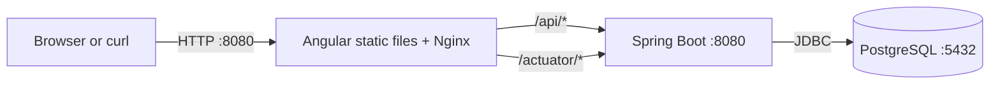
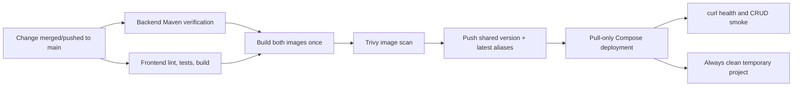
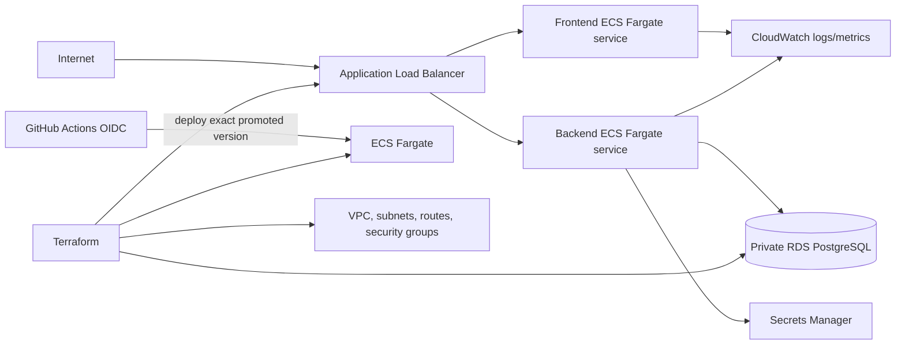
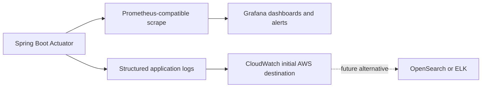

# Architecture

This training project keeps the Notes workload small so the delivery lifecycle remains the focus. Current implementation and evidence are in [current state](current-state.md); target choices and sequencing are in the [charter](project-charter.md) and [roadmap](roadmap.md).

## 1. Current local application architecture

Angular uses relative `/api/notes` paths. Nginx serves the built SPA and proxies API/Actuator routes to `backend`. The API is Spring Boot 4.1.1 / Java 25 with JPA, validation, Actuator health/info, and Flyway migrations. PostgreSQL 17.7 is the persistence store. Both root `compose.yaml` (local build) and `deploy/compose.yaml` (pull-only) define PostgreSQL health and service ordering; release images also have application health checks.

The notes API supports list/get/create/update/delete. Required nonblank title and content have limits of 120 and 10,000 characters. Flyway owns DDL; Hibernate validates it. This is a small training CRUD service, not a production-grade data platform.

## 2. CI/CD architecture

`.github/workflows/ci-cd.yml` also supports manual dispatch. Its automatic push trigger is `main` only. Backend and frontend test jobs gate image build/publish. Trivy is configured to fail on fixable critical findings; an unavailable vulnerability database blocks publication. Deployment consumes a version output and does not select `latest`.

`.github/workflows/container-validation.yml` runs on non-`main` branch pushes that touch app, Compose, or smoke-test paths (and on manual dispatch). It builds both Dockerfiles, checks non-root users and HEALTHCHECKs, runs the pull-only release Compose file with the locally built images, smoke-tests, tears down, and uploads the images as a short-lived artifact. It publishes nothing.

The version format is initially `1.0.${{ github.run_number }}`. **The implementation does not guarantee immutability:** Actions re-runs reuse the run number and may republish that version tag. Do not claim immutable artifact promotion; Milestone 6 tracks hardening.

## 3. Docker Hub artifact flow

Source is the checked-out repository commit. Build output is two application images (frontend and backend), sharing the same version. The workflow scans the images before pushing numbered and `latest` tags to Docker Hub. `latest` is a convenience alias, not a deployment reference. PostgreSQL is an upstream runtime dependency, not an application image published by this pipeline.

The workflow expects repository variable `DOCKERHUB_USERNAME` and secret `DOCKERHUB_TOKEN`. The current deploy job does not log into the registry, so the versioned images must be anonymously pullable unless that behavior is intentionally changed. No registry contents, credentials, or successful publication are inferred from this architecture description.

## 4. Temporary deployment acceptance

The deploy job pulls both exact numbered application images using `deploy/compose.yaml`, starts PostgreSQL and the app services, waits for health, runs `scripts/smoke-test.sh`, and runs Compose cleanup even on failure. The smoke test checks frontend availability, backend health through Nginx, then creates, retrieves, and deletes one note.

This is temporary GitHub-runner acceptance and is removed afterward. It is not a persistent environment, rollback-capable service, or proof of cloud deployment.

## 5. Future AWS ECS architecture (PLANNED)

The target is Terraform-managed VPC/public-private networking, security groups, ALB, ECS Fargate services/task definitions, private RDS PostgreSQL, Secrets Manager, CloudWatch logs, and least-privilege IAM. AWS OIDC is preferred for deployment authentication. ECR may be selected for an AWS-local registry or promotion, but Docker Hub remains the initial registry. Whether the image is copied/promoted to ECR or pulled directly must be decided and documented before AWS deployment. No AWS resources or account access are implied by this plan. EKS is not planned.

## 6. Future observability architecture (PLANNED)

First stabilize deployment. Then implement and validate request count, latency, error rate, JVM health, container availability, and database connectivity metrics plus actionable alerts. Centralized logs start with CloudWatch on AWS; evaluate ELK/OpenSearch later against training objectives, retention needs, operating cost, and permissions. Do not operate an observability stack before its prerequisites.

## 7. Trust and credential boundaries

- Personal GitHub CLI/Git operations, work-managed GHE Copilot entitlement, personal Docker Hub, and training-center AWS account are separate identities.
- Do not copy credentials across identities or store them in the repository. Docker Hub token is a GitHub secret; AWS should use approved temporary identity/OIDC rather than long-lived keys.
- GitHub Actions, Docker Hub, AWS, and public image registries are distinct trust boundaries. Restrict permissions and OIDC trust to the intended repository and branch/environment.
- Treat application images as artifacts: test, build, scan, publish once, then deploy an exact version. Current workflow tag immutability is not enforced.
- The prior development environment had enterprise proxy/firewall constraints. Do not store its settings here or blindly remove proxy configuration on another machine.

## Evidence boundary

This file describes current repository configuration and future target architecture. It does not certify that an Actions run, Docker Hub push/pull, remote acceptance, AWS deployment, metrics collection, alert, or centralized logging has occurred. See [current state](current-state.md).
